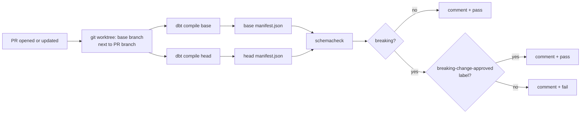

# schema-change-checker

**Catch breaking dbt changes on the pull request, not in next week's dashboard.**

[](https://github.com/thotaarchitha/schema-change-checker/actions/workflows/ci.yml)
[](https://github.com/thotaarchitha/schema-change-checker/actions/workflows/schema-check.yml)

Everyone who has worked on a data team has seen this one: somebody drops or renames a
column in a staging model, the PR looks harmless, it merges, and three days later finance
asks why the revenue dashboard is blank. dbt's tests didn't catch it because nothing was
*wrong* with the data. A column was just gone.

This is a GitHub Action that reads the dbt manifest from both sides of a PR, works out
column-level lineage with [sqlglot](https://github.com/tobymao/sqlglot), and comments on
the PR with exactly which models and dashboards the change breaks. If something breaks, the
check fails, unless someone deliberately adds the `breaking-change-approved` label.

## What it posts

This is the real output for the first seeded test case (dropping `discount` from `stg_orders`):

> ### Schema Change Checker: 1 breaking change
>
> **stg_orders**: column `discount` was REMOVED
> - Breaks:
>   - `int_order_totals.discount_amount` (uses stg_orders.discount)
>   - `int_order_totals.net_amount` (uses stg_orders.discount)
>   - `fct_orders.discount_amount` (via int_order_totals.discount_amount)
>   - `fct_orders.net_revenue` (via int_order_totals.net_amount)
>   - `mart_daily_revenue.net_revenue` (via fct_orders.net_revenue)
> - Dashboards affected: Revenue Dashboard (exposure)
>
> **Result: FAILED.** Add the label `breaking-change-approved` to merge anyway.

Notice what's *not* in there: `mart_customer_ltv` also reads from `fct_orders`, but it's
built from payments, not from net revenue, so it's not affected. Model-level lineage
(`dbt ls --select stg_orders+`) would have flagged it anyway. That gap is the whole reason
to go down to columns.

## Try it

These PRs are left open on purpose. Click one to see the check and its comment:

| PR | What it changes | Expected |
|---|---|---|
| Drop `discount` from `stg_orders` | removes a column three models depend on | fails, 3 models + Revenue Dashboard |
| Rename customer `email` | `email` → `email_address` in staging only | fails, recognised as a rename |
| Rename customer `email`, update downstream | same rename, `dim_customers` updated in the same PR | passes with a warning |
| Add `full_name` to `stg_customers` | new column | passes, listed as safe |

[Open pull requests →](https://github.com/thotaarchitha/schema-change-checker/pulls)

## How it works



Inside `schemacheck`, in order:

1. **Load the manifest** ([manifest.py](schemacheck/manifest.py)). Models, seeds, sources and exposures, plus a networkx graph in dependency order.
2. **Work out each model's output columns** ([schema.py](schemacheck/schema.py)). Seeds come from their CSV headers. Models get parsed and qualified with sqlglot in dependency order, so `SELECT *` expands against whatever upstream really returns.
3. **Find broken references on the head branch** ([impact.py](schemacheck/impact.py)). I walk every scope (CTEs, subqueries, joins, WHERE, GROUP BY) and collect each column that points at something that no longer exists.
4. **Classify the changes** ([diff.py](schemacheck/diff.py)). Removed, renamed, added, model removed, model added.
5. **Build column-level lineage** ([lineage.py](schemacheck/lineage.py)). Edges are column to column, e.g. `stg_orders.discount → int_order_totals.discount_amount`.
6. **Walk downstream in base lineage** for every breaking change, and add every exposure that sits on an affected model.
7. **Write the report** ([report.py](schemacheck/report.py)). Markdown for the PR comment and JSON for anything else. Exit code `0` means nothing breaks, `1` means something breaks, `2` means the checker itself failed.

The longer version, with the reasoning behind each step, is in [docs/how-it-works.md](docs/how-it-works.md).

## Quick start

No database needed. The test fixtures are real compiled manifests:

```bash
pip install -r requirements.txt
python -m schemacheck --base tests/fixtures/01_drop_used_column/base/manifest.json --head tests/fixtures/01_drop_used_column/head/manifest.json
pytest -q
```

To run it against two branches of the sample warehouse yourself:

```bash
docker compose up -d --wait          # PG_PORT=5433 if you already run Postgres on 5432
export DBT_PG_PASSWORD=dev           # DBT_PG_PORT=5433 to match, if you changed it
cd warehouse && dbt build --profiles-dir .
```

Then compile on each branch, copy `target/manifest.json` aside, and pass the two files
to `--base` and `--head`. That's what the workflow does with `git worktree`.

## The sample warehouse

The checker needs something worth protecting, so `warehouse/` is a small but real dbt
project on fake shop data (Faker, fixed seed: 5,000 customers, 500 products, 50,000
orders, ~117k order lines, ~45k payments).

- **staging**: `stg_customers`, `stg_products`, `stg_orders`, `stg_order_items`, `stg_payments`
- **intermediate**: `int_order_totals`, `int_customer_orders`
- **marts**: `dim_customers`, `dim_products`, `fct_orders`, `mart_daily_revenue`, `mart_customer_ltv`
- **exposures**: Revenue Dashboard and Customer Health Report
- **dbt tests**: 27 in total (unique and not_null on keys, relationships, accepted_values on order status)

The SQL deliberately covers the awkward cases: CTEs, a column renamed inside a CTE
(`discount as discount_rate`), CASE expressions, aggregates, and one `select *`
(`dim_products`), because that's where lineage tools tend to quietly give up.

## Design decisions

The short version is below. The long version is [docs/design-decisions.md](docs/design-decisions.md).

- **Compiled SQL, not raw dbt code.** Jinja isn't SQL, and `{{ ref() }}` already resolves to a real table name in `compiled_code`.
- **Head for "is it broken", base for "what does it break".** If the PR also updated the downstream models, head has no broken references and the check passes. But to explain a break you need the graph that still has the column in it, and that's base.
- **Renames** are a removed column plus an added column in the same model, built from the same upstream columns. When two new columns share those inputs, an identical SQL expression breaks the tie. If it's still a tie, I report a drop plus an add rather than guess.
- **Removals that cascade through `SELECT *`** are reported once, at the root. Dropping `stg_products.category` makes `dim_products.category` disappear silently, and two separate "removed" lines would bury the actual cause.
- **Removing a column from a model that feeds an exposure counts as breaking,** even if no dbt model uses it. dbt can't see which columns a dashboard reads, so I assume it reads this one.

## Limitations

These are real and I'd rather list them than have someone find them:

- **Postgres only.** The dialect is hard-coded. sqlglot supports others, but I haven't tested any.
- **Dynamic SQL in macros.** I only see what `dbt compile` produced on each branch. A macro that builds different SQL in production than in CI is invisible.
- **`SELECT *` from a source without documented columns.** If I don't know the columns, I can't expand the star. Those models get listed under "things the checker couldn't see" instead of being checked.
- **Type changes aren't detected yet.** The plan is to diff `catalog.json` from `dbt docs generate`. That isn't built.
- **Deleting a model that's still `ref()`'d** fails `dbt compile` before the checker even runs. The workflow posts the compile error as the comment, which is accurate but less helpful than a lineage chain.
- **Meaning changes without schema changes** (say, `net_revenue` quietly starts including tax) are out of scope. No schema diff can catch that.
- **Fork PRs** get a read-only token and can't post the comment. The check result and the job summary still work.
- **BI tools outside dbt** only count if they're declared as exposures.

## Repo layout

```
schemacheck/            the checker (~900 lines including comments)
warehouse/              sample dbt project + seeds
scripts/generate_seeds.py
tests/fixtures/         base/head manifest pairs for the 10 seeded changes
tests/                  pytest, runs without a database
.github/workflows/      ci.yml (lint, tests, dbt build) and schema-check.yml (the PR check)
docs/                   how it works, design decisions, bug journal
```

MIT licensed.
